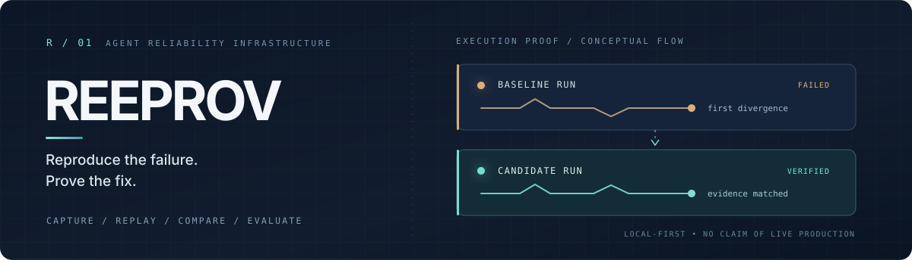

  

  <h1>REEPROV</h1>

  **The debugging and regression lab for AI agents.**

  Capture what happened. Replay recorded boundaries. Find the first divergence. 
  Test a candidate fix before the same failure reaches production again.

  

    
    
    
    
  

  [**Get started**](#quick-start) &nbsp;·&nbsp; [**Workflow**](#the-debugging-loop) &nbsp;·&nbsp; [**SDKs**](#instrument-your-agent) &nbsp;·&nbsp; [**Evidence**](#verified-behavior) &nbsp;·&nbsp; [**Docs**](docs/README.md)

---

## When a trace is not enough

An agent reports *"done."* But the API state is wrong, a tool was called twice, or the next run makes a different decision. A trace tells you **what** happened. It rarely gives you a safe way to reproduce **why**, change one variable, and determine whether a fix holds.

Reeprov is built around a different workflow.

<table>
<tr>
<td width="33%" valign="top">

**01 / CAPTURE THE EVIDENCE**

Record model, tool and retrieval boundaries with stable identities, content availability and execution outcomes.

</td>
<td width="33%" valign="top">

**02 / RECREATE THE FAILURE**

Re-execute compatible host logic against recorded responses. Refuse missing or changed evidence rather than silently inventing it.

</td>
<td width="33%" valign="top">

**03 / QUALIFY THE FIX**

Compare trajectories, inspect the first divergence, evaluate assertions and gate regressions before release.

</td>
</tr>
</table>

## The debugging loop

~~~mermaid
flowchart LR
    A["Agent execution"] --> B["Capture evidence"]
    B --> C["Inspect trajectory"]
    C --> D["Offline replay"]
    D --> E["Fork at checkpoint"]
    E --> F["Compare outcomes"]
    F --> G["Evaluate"]
    G --> H{"Regression gate"}
    H -->|"Pass"| I["Release evidence"]
    H -->|"Fail"| C
~~~

| Capability | What it gives you |
| :-- | :-- |
| **Boundary-aware capture** | Model, tool and retrieval events, canonical hashes, secret redaction and an inspectable timeline |
| **Offline replay** | Recorded boundary substitution with explicit match, divergence, block or unsupported outcomes |
| **Checkpoint-based forks** | Resume compatible host adapters from verified checkpoints with controlled state mutations |
| **Run comparison** | Aligned differences, first divergence and evidence-linked candidate comparisons |
| **Evaluation & regression gates** | Versioned checks, baseline comparisons and CI-friendly pass/fail evidence |
| **Studio · CLI · SDKs** | Visual investigation, scriptable workflows and TypeScript, Python or REST ingestion |

**Positioning:** Reeprov is not a model provider, agent orchestrator or hosted observability SaaS. It is an **evidence and verification layer** around agents you already run.

## Failure → fix: a reproducible example

The [Sprint 13 acceptance exercise](docs/testing/S13-acceptance.md) uses a **synthetic incident-triage agent** to test the full journey, not merely a dashboard mock-up.

<table>
<tr>
<td width="50%" valign="top">

**BASELINE / FAILED**

- Incident classified and deferred
- **1 / 5** evaluation assertions passed
- Original execution captured as replay evidence

</td>
<td width="50%" valign="top">

**CANDIDATE / VERIFIED IN TEST**

- Compatible host adapter resumed from checkpoint
- Changed policy produced a different action
- **5 / 5** evaluation assertions passed
- Comparison identified the meaningful divergence

</td>
</tr>
</table>

That acceptance also exercises changed-input replay, redacted-content partial verification, checkpoint persistence and blocked simulated side effects. **These results are synthetic and bounded.** They are not production success rates or evidence of universal agent reliability. [Inspect the methodology and results](docs/testing/S13-acceptance.md).

---

## Quick start

**Requires Node.js 20+ and npm.** The root application runs from source; it is not published as an npm package.

~~~bash
git clone https://github.com/RaulMermans/Reeprov.git
cd Reeprov
npm ci
npm run dev
~~~

Open **http://localhost:3000/dashboard**. Default <code>personal_local</code> mode stays on loopback with no dashboard login.

**No external agent yet?** Load a deterministic example:

~~~bash
npm run reeprov -- demo setup
# Explore Projects, Runs, Compare, Evals and Regressions
npm run reeprov -- demo reset
~~~

To run a private Docker instance, configure distinct <code>REEPROV_ACCESS_KEY</code> and <code>REEPROV_INGEST_KEY</code> secrets, then execute <code>docker compose up -d</code>. The supplied Compose file binds to loopback by default. [Deployment guide](docs/DEPLOYMENT.md).

## Instrument your agent

Connect using the [TypeScript SDK](packages/client-typescript/README.md), [Python SDK](packages/client-python/README.md) or [REST API](examples/integrations/rest/README.md). Create a project in Studio and obtain a project-scoped ingest key. **Do not commit credentials.**

~~~bash
npm install @reeprov/client
~~~

~~~typescript
import { ReeprovClient } from "@reeprov/client";

const client = new ReeprovClient({
  url: process.env.REEPROV_URL ?? "http://127.0.0.1:3000",
  ingestKey: process.env.REEPROV_INGEST_KEY!,
  projectId: "incident-triage",
  workflowId: "triage-v1",
});

const run = await client.startRun({ summary: "Investigate incident INC-2041" });

await client.modelCallCompleted({
  run_id: run.run_id,
  provider: "anthropic",
  model: "example-model",
  prompt: "Classify this incident",
  response: { severity: "SEV3" },
});

await client.toolCallCompleted({
  run_id: run.run_id,
  tool_name: "tickets.create",
  arguments: { incident_id: "INC-2041" },
  output: { ticket_id: "T-2041" },
  permission_class: "external_side_effect",
});

await client.completeRun({
  run_id: run.run_id,
  summary: "Run captured for inspection",
});
~~~

*Illustrative data only.* Capture alone does **not** make arbitrary agent code replayable. Replay and fork require steps built around injectable host dependencies and a compatible host adapter; the runner executes on your machine rather than inside the Reeprov server. [Host adapter documentation](packages/client-typescript/README.md#acknowledgements-checkpoints-and-replay) · [External-agent acceptance](docs/testing/S13-acceptance.md).

<strong>Python SDK and package availability</strong>

The Python client is source-installable and supports evidence capture, but **is not published to PyPI**. The JavaScript/TypeScript host replay/fork runner does not execute Python host code.

~~~bash
pip install ./packages/client-python
~~~

[Python SDK guide](packages/client-python/README.md).

### Use the CLI

~~~bash
npm run reeprov -- --help
npm run reeprov -- projects list
npm run reeprov -- replay <run-id-or-path> --strict
npm run reeprov -- diff <run-a> <run-b> --first-divergence
npm run reeprov -- regression check <candidate-run-id> --baseline <baseline-id>
~~~

---

## Architecture

~~~mermaid
flowchart TB
    subgraph Host["Your agent / your runtime"]
        SDK["TypeScript SDK · Python SDK · REST"]
        ADAPTER["Optional host replay adapter"]
    end

    subgraph App["Reeprov · local or private self-hosted"]
        API["Run and boundary contracts"]
        DB[("Evidence store")]
        REPLAY["Replay & fork"]
        CHECK["Compare · evaluate · regressions"]
        STUDIO["Studio & CLI"]
    end

    SDK --> API --> DB
    DB --> REPLAY --> CHECK
    ADAPTER <--> REPLAY
    DB --> STUDIO
    CHECK --> STUDIO
~~~

Reeprov records canonical evidence; compatible host adapters own re-execution. **Observing a trace does not recreate an entire operating environment.**

[System architecture](docs/ARCHITECTURE.md) · [Boundary model](docs/architecture/boundary-model.md) · [Replay](docs/architecture/offline-replay-runtime.md) · [Forking](docs/architecture/fork-runtime.md) · [Regression gates](docs/architecture/regression-gates.md)

## Privacy, operating modes & limits

| Mode | Intended use | Boundary |
| :-- | :-- | :-- |
| <code>personal_local</code> **(default)** | Individual workstation | Loopback only; no dashboard login |
| <code>self_hosted</code> | Private server / Docker | Password-protected Studio; operator-controlled network binding |
| <code>headless_ci</code> | Automated capture and checks | Ingest-key operation; no Studio required |

**Local-first:** Reeprov does not operate a managed cloud service for your traces. Data stays in a store you control (local files by default, or optional self-hosted PostgreSQL).

> [!IMPORTANT]
> **Offline replay is not an OS sandbox.** Strict replay substitutes recorded outputs and intercepts known Node network and subprocess APIs. It does not guarantee zero egress from untrusted host code. Use a separately network-isolated process or container for stronger guarantees. Missing or redacted payloads may prevent full verification. [Replay safety model](docs/security/offline-replay-safety.md).

For private deployments, keep the access password distinct from the ingest key. [Capture/redaction](docs/security/capture-and-redaction.md) · [Security policy](SECURITY.md) · [Modes](docs/architecture/deployment-modes.md)

## Verified behavior

| Evidence | Scope |
| :-- | :-- |
| **Automated CI** | Rename and private-path audits, lint, typecheck, deterministic tests and Next.js production build |
| **Replay proofs** | Boundary divergence, side-effect blocking, checkpoint integrity and run differences |
| **Sprint 13 acceptance** | Synthetic external SDK run, strict host replay, resumed fork, evaluation, Docker persistence and Playwright walkthrough |
| **Research testbed** | Separate matched offline cross-agent verification study; **not** a production-effectiveness benchmark |

[Acceptance evidence](docs/testing/S13-acceptance.md) · [Replay proof](docs/testing/offline-replay-proof.md) · [Regression proof](docs/testing/regression-drift-proof.md)

<strong>Research extension · KARMA POLICE</strong>

The research testbed evaluates cross-agent claim verification and handoff inconsistencies. In a 16-scenario offline, post-freeze evaluation pack, the selected detector correctly classified **68 / 88** claims and detected **16 / 20** contradictions. This is a small, evaluator-controlled study—not independent blinded validation, live production deployment or a general capability benchmark.

[Methods, raw counts and limitations](docs/research/karma-police-h2-results.md).

### Reproduce the quality gates

~~~bash
npm ci
npm run ci
~~~

The standard CI pipeline runs without requiring live calls to external model providers.

---

## Status & documentation

**Public beta · local-first developer tooling.** Studio and CLI run from the repository; the TypeScript SDK has an npm package, while the Python SDK is source-installable. No claim of independent security certification, unattended production readiness or universal replay support.

| Explore | Documentation |
| :-- | :-- |
| Product | [Studio navigation](docs/product/studio-navigation.md) · [Connect an agent](docs/product/connect-agent.md) |
| Engineering | [Architecture](docs/ARCHITECTURE.md) · [API stability](docs/architecture/api-stability.md) · [Data model](docs/DATA_MODEL.md) |
| Evidence | [Acceptance](docs/testing/S13-acceptance.md) · [Research](docs/research/karma-police-h2-results.md) |
| Operations | [Deployment](docs/DEPLOYMENT.md) · [AgentPulse migration](docs/migration/agentpulse-to-reeprov.md) |
| Collaboration | [Contributing](CONTRIBUTING.md) · [Code of conduct](CODE_OF_CONDUCT.md) · [Security](SECURITY.md) |

---

REEPROV &nbsp; / &nbsp; CAPTURE WHAT HAPPENED. REPRODUCE WHAT MATTERS. VERIFY WHAT CHANGED.

Open source under <a href="LICENSE">Apache License 2.0</a>.

