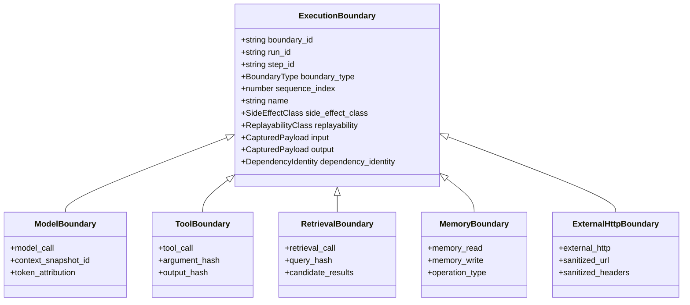
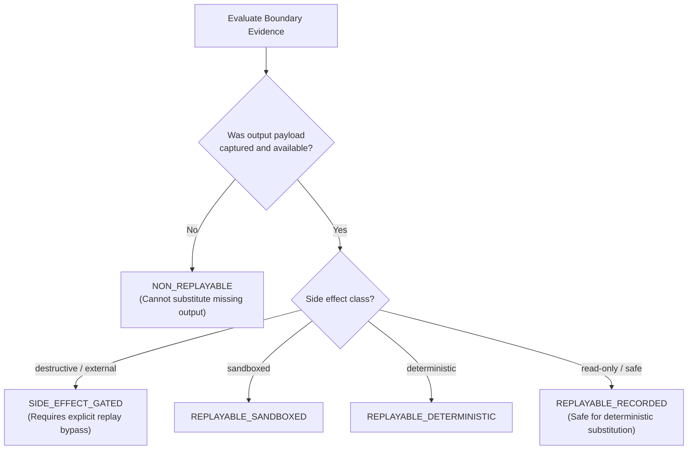

# AgentPulse Execution Boundary Model

> **Definition:** The formal taxonomy and structural model describing nondeterministic interaction points between an autonomous agent and external systems.

---

## 1. Execution Steps vs. Execution Boundaries

A common failure mode in agent tracing is conflating **internal control flow** with **external interaction points**. AgentPulse enforces a strict separation:

| Concept | Contract | Scope | Role in Replay |
|---|---|---|---|
| **Execution Step** | [`ExecutionStep`](../../lib/core/contracts/executionStep.ts) | High-level logical block of work (e.g. `Agent Planning Phase`, `Task Evaluation Loop`). | Defines trajectory sequence and nesting; cannot be substituted directly. |
| **Execution Boundary** | [`ExecutionBoundary`](../../lib/core/contracts/replay.ts) | Specific nondeterministic boundary crossing with an external system (LLM, tool, vector index, memory, HTTP API). | Unit of deterministic offline substitution; captures inputs, outputs, hashes, and side effects. |

A single `ExecutionStep` may encompass zero, one, or multiple `ExecutionBoundary` records.

---

## 2. Boundary Taxonomy

AgentPulse recognizes eight first-class execution boundary types:



### Supported Boundary Types

1. **`model_call`:** LLM generation invocations (Anthropic, OpenAI, local models). Captures prompt, tools exposed, generation parameters, latency, token usage, and links to a materialized [`ContextSnapshot`](../../lib/core/contracts/context.ts).
2. **`tool_call`:** Invocation of agent tools and functions. Captures canonical tool name, arguments, argument hashes, output, duration, and error states.
3. **`retrieval_call`:** Vector database and search queries (RAG). Captures search query, collection identity, top-k parameters, candidate results with scores and ranks, and tracks whether items entered model context.
4. **`memory_read`:** Direct lookups or similarity recall from episodic/semantic/procedural memory stores.
5. **`memory_write`:** Mutations to external agent memory (committed writes, updates, deletions, consolidations).
6. **`external_http`:** Raw REST/HTTP requests made to third-party endpoints. Captures sanitized URL, scrubbed headers, and response payload.
7. **`code_execution`:** Execution of code in sandboxes or local interpreters (optional boundary).
8. **`filesystem_read` / `filesystem_write`:** File operations performed by workspace agents (optional boundary).

---

## 3. Side-Effect Classification

Operations are classified into five side-effect tiers by [`sideEffectClassifier.ts`](../../lib/core/capture/sideEffectClassifier.ts):

| Class | Invariant | Examples |
|---|---|---|
| `read_only` | Idempotent, emits no side effects, safe to replay arbitrarily. | `search_docs`, `get_customer_profile`, `read_file` |
| `write_draft` | Creates reversible, draft-stage mutations without real-world impacts. | `create_draft_email`, `stage_git_commit` |
| `external_side_effect` | Performs non-reversible external interactions. Requires approval to substitute in replay. | `send_email`, `post_slack_message`, `charge_customer` |
| `sensitive_data` | Touches PII, credentials, or restricted customer data. Requires policy approval. | `fetch_ssn`, `export_database_dump` |
| `destructive` | Irrevocably destroys or mutates system state. Blocked during offline replay. | `delete_database`, `terminate_instance`, `rm_rf` |

### Fail-Closed Principle
Unknown tools default to `external_side_effect` unless explicitly registered or exhibiting unequivocal read-only semantics. AgentPulse **never assumes a tool is safe to replay simply because it completed successfully**.

---

## 4. Evidence-Based Replayability Classification

A boundary cannot be deemed replayable solely because a response was received. [`replayabilityClassifier.ts`](../../lib/core/capture/replayabilityClassifier.ts) evaluates concrete evidence:



### Taxonomy of Replayability Classes

- **`REPLAYABLE_RECORDED`:** Fully captured input and output; safe for offline deterministic playback.
- **`REPLAYABLE_DETERMINISTIC`:** Pure deterministic function; can be recalculated on demand.
- **`REPLAYABLE_SANDBOXED`:** Executed within an isolated sandbox (e.g. Docker container) with reproducible environment state.
- **`SIDE_EFFECT_GATED`:** Contains real-world mutations; blocked during offline replay unless explicitly overridden.
- **`LIVE_REQUIRED`:** Missing captured evidence; requires live connection to external systems.
- **`NON_REPLAYABLE`:** Output unavailable, corrupt, or failed during execution without capture.
- **`UNKNOWN`:** Incomplete telemetry prevents classification.

---

## 5. Input & Output Representation

Every boundary contains structured representations of both sides of the boundary crossing:

```typescript
{
  "boundary_id": "bnd_tool_call_run_001_1",
  "run_id": "run_001",
  "sequence_index": 1,
  "boundary_type": "tool_call",
  "name": "get_customer_account",
  "status": "completed",
  "replayability": "REPLAYABLE_RECORDED",
  "side_effect_class": "read_only",
  "input": {
    "captured": true,
    "content": { "customerId": "cus_1001" },
    "hash": "sha256:d8912ef6c7...",
    "redaction_status": "none",
    "availability": "CAPTURED"
  },
  "output": {
    "captured": true,
    "content": { "customerId": "cus_1001", "balance": 150, "currency": "USD" },
    "hash": "sha256:a41bc30d9e...",
    "redaction_status": "none",
    "availability": "CAPTURED"
  },
  "content_hashes": {
    "input_hash": "sha256:d8912ef6c7...",
    "output_hash": "sha256:a41bc30d9e..."
  },
  "dependency_identity": {
    "provider": "agent_system",
    "service": "customer_database",
    "endpoint": "get_customer_account"
  }
}
```

This complete record enables the [`BoundaryReplayHarness`](../../lib/core/capture/replayHarness.ts) to verify inputs down to the cryptographic hash and substitute recorded outputs without touching the live database.
