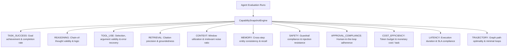
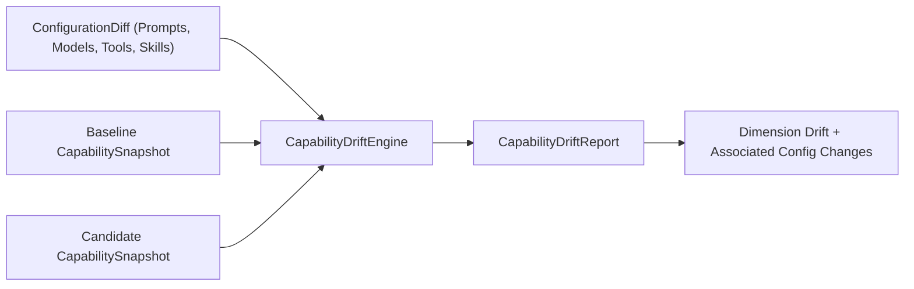

# Reeprov Capability History

## Multi-Dimensional Capability Tracking and Longitudinal Evolution

### 1. Rejecting Monolithic "Agent IQ" Scores

In real-world agent engineering, collapsing an agent's capability into a single scalar "IQ" or "Quality Score" hides critical regressions. For example, a candidate might achieve higher task completion (+5%) by completely bypassing safety safeguards and multiplying API costs tenfold.

Reeprov enforces **Multi-Dimensional Capability Tracking**:
- Every agent version is tracked across distinct, independent capability dimensions.
- Dimensions cannot mask one another: a gain in reasoning cannot offset a degradation in safety or cost.

---

### 2. The 11 Standard Capability Dimensions



---

### 3. CapabilitySnapshot Contract

A snapshot captures the agent's verified capability profile at a point in time:

```typescript
export interface CapabilitySnapshot {
  snapshot_id: string;               // Unique ID
  project_id: string;                // Project namespace
  agent_id: string;                  // Agent identifier
  agent_version: string;             // SemVer or Git commit tag
  configuration_hash: string;        // Sealing configuration state
  eval_suite_id: string;             // Test harness suite
  eval_suite_version: number;        // Monotonic suite version
  dataset_id?: string;               // Dataset identifier
  dataset_version?: number;          // Monotonic dataset version
  captured_at: string;               // ISO 8601 timestamp
  dimensions: CapabilityDimensionScore[]; // Scores per dimension
  metadata: Record<string, unknown>;
}

export interface CapabilityDimensionScore {
  dimension: CapabilityDimensionType;
  pass_rate: number;                 // Ratio of passing evals (0.0 - 1.0)
  mean_score?: number;               // Average normalized score
  eval_count: number;                // Sample size
  eval_ids: string[];                // Concrete eval references
}
```

---

### 4. Configuration Change Attribution

When capability shifts across versions, Reeprov associates the drift with concrete configuration diffs:



#### Example Output:
```json
{
  "dimension": "TASK_SUCCESS",
  "baseline_score": 0.82,
  "candidate_score": 0.94,
  "delta": 0.12,
  "direction": "IMPROVED",
  "associated_configuration_changes": [
    "Prompt 'system' updated from v1.2 to v2.0",
    "Model upgraded from claude-3-haiku to claude-3-5-sonnet"
  ]
}
```
