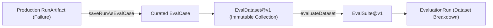

# Evaluation Datasets Architecture

> **Canonical Role:** Immutable benchmark test collections and historical failure curation for AgentPulse.

---

## 1. Overview

AgentPulse treats test cases and datasets as versioned, immutable assets. Curation from production failures into regression suites is an explicit user-driven action, not an automatic side effect.

---

## 2. Contracts

### `EvalCase`

Represents an individual unit test or benchmark scenario:
- `case_id`: Unique case identifier.
- `name`: Human-readable test scenario name.
- `input`: Input payload or reference passed to the agent.
- `expected`: Expected outcome status, payload, or tool invocations.
- `source_run_id`: Historical run from which this case was curated (if applicable).
- `source_checkpoint_id`: Point-in-time checkpoint reference.
- `artifact_refs`: References to input documents or logs.
- `tags`: Categorization labels (e.g. `["regression", "payment", "high_value"]`).
- `metadata`: Additional diagnostic context.

### `EvalDataset`

An immutable collection of `EvalCase` items:
- `dataset_id`: Unique collection identifier.
- `name` & `description`: Overview of benchmark purpose.
- `version`: Dataset version integer.
- `cases`: Array of `EvalCase` objects.
- `content_hash`: Deterministic hash of dataset cases.

---

## 3. Curating Production Failures (`saveRunAsEvalCase`)

When an agent fails in production or testing, AgentPulse provides an explicit curation workflow:
1. The developer inspects the failure in Run Debugger.
2. The user initiates `saveRunAsEvalCase(runId, options)` targeting an existing or new dataset.
3. The engine extracts the initial input, checkpoint reference, artifacts, and failure metadata.
4. The newly curated `EvalCase` is appended to the versioned `EvalDataset`.
5. The dataset is immediately available for regression testing across candidate variants in Experiment Lab.
