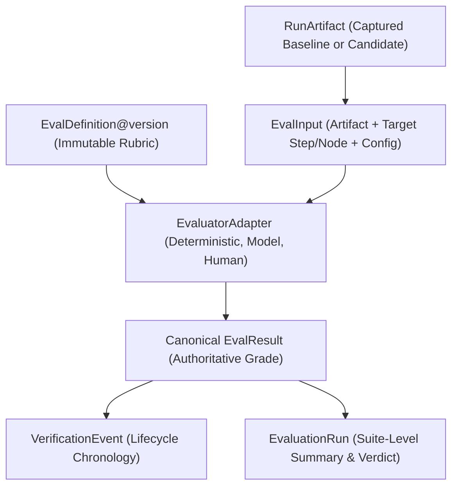

# Evaluation Architecture Model

> **Canonical Role:** Authoritative, versioned, run-linked evaluation model for Reeprov.

---

## 1. Overview & Architectural Boundaries

Reeprov evaluates agent runs by turning execution hypotheses into repeatable, verifiable measurements without becoming an arbitrary production agent orchestrator:

- **What Reeprov Does:**
  - Evaluates historical run artifacts, recorded checkpoints, and forked candidate executions.
  - Links evaluation definitions (`EvalDefinition`) and suites (`EvalSuite`) to execution runs.
  - Generates immutable `EvalResult` artifacts with deterministic hashes, rubric/version references, and execution durations.
  - Computes deterministic pass/fail verdicts via strict suite policies (`ALL_REQUIRED_PASS`, `WEIGHTED_SCORE`).
  - Emits `VerificationEvent` lifecycle events onto the evaluated run artifact.

- **What Reeprov Does NOT Do:**
  - Own arbitrary production agent workflows.
  - Automatically promote candidate agents to production without explicit human or external CI gate approval.
  - Mutate external memory or database systems.
  - Execute untrusted tool side effects during evaluation.

---

## 2. Canonical Contracts

### `EvalDefinition`

An immutable definition describing *what* is being evaluated:
- `eval_definition_id`: Unique identifier.
- `name` & `description`: Human-readable label and intent.
- `family`: One of 15 canonical eval families (`task_success`, `output_validity`, `schema_validity`, `tool_selection`, `argument_validity`, `retrieval_quality`, `context_utilization`, `memory_accuracy`, `trajectory_efficiency`, `safety`, `approval_compliance`, `regression`, `cost`, `latency`, `benchmark`).
- `version`: Monotonically increasing version number (e.g. 1, 2).
- `target_scope`: `RUN`, `STEP`, `MODEL_CALL`, `TOOL_CALL`, `RETRIEVAL`, `CONTEXT`, `MEMORY`, `ARTIFACT`, or `COMPARISON`.
- `grader_type`: `deterministic`, `model_based`, or `human`.
- `severity`: `info`, `warning`, `fail`, or `critical`.
- `required`: Boolean flag for suite-level pass gate.
- `grader_config`: Structured configuration payload (e.g. assertions, thresholds, model prompt).
- `evidence_requirements`: Array of required evidence categories (e.g. `["tool_call"]`, `["final_outcome"]`, `["context"]`).
- `content_hash`: SHA-256 hash of definition contents.
- `status`: `active`, `deprecated`, or `draft`.

### `EvalResult` (Canonical Source of Truth)

Authoritative result emitted by an evaluator:
- `eval_id`: Unique result identifier.
- `eval_definition_id` & `eval_definition_version`: Linkage to exact immutable definition.
- `eval_suite_id` & `eval_suite_version`: Optional linkage to parent suite.
- `eval_type`: Preserved canonical family.
- `evaluator_id` & `evaluator_version`: Exact evaluator adapter responsible for the grade.
- `target_run_id`, `target_step_id`, `target_node_id`: Explicit provenance to target artifact.
- `passed`: Boolean pass/fail verdict.
- `score`: Normalized score ($0.0 - 1.0$).
- `severity`: Severity classification.
- `grader_type`: `deterministic`, `model_based`, or `human`.
- `grader_status`: `PASSED`, `FAILED`, `MISSING_EVIDENCE`, `EVALUATOR_ERROR`, or `SKIPPED`.
- `evidence_references`: Identifiers of verified tool calls, snapshots, or trace items.
- `findings`: Concrete observed findings.
- `recommendation`: Actionable remediation guidance.
- `execution_duration_ms`: Execution time taken by the grader.
- `grader_cost_usd`: Model inference cost incurred by the grader.

---

## 3. Lossless Compatibility Adapter

To preserve backward compatibility with legacy proof-layer schemas without loss of information:
- The canonical `EvalResult` (`lib/core/contracts/evals.ts`) is authoritative.
- Legacy projection (`toLegacyEvalResult` in `lib/core/adapters/evalCompatibility.ts`) maps canonical families to legacy types while preserving the exact `canonical_family` in compatibility metadata.
- Canonical persistence projection never maps non-schema evals into `type: "schema_validity"`.
- Round-trip conversion (`toCanonicalEvalResult`) restores the exact original canonical family.

---

## 4. Evaluator Error vs Agent Failure

Evaluation infrastructure issues must never masquerade as agent failures:
1. **Missing Evidence:** If an evaluation requires evidence (e.g., `tool_call`) that was not captured in the artifact, `grader_status` is recorded as `MISSING_EVIDENCE`.
2. **Grader Timeout / Invalid Output:** If a model judge times out or returns malformed JSON, `grader_status` is recorded as `EVALUATOR_ERROR`.
3. **Agent Failure:** Only recorded when required evidence was present and the agent's behavior definitively failed the asserted criterion.

---

## 5. Pass Policies & Critical Gate Overrides

Eval suites support two deterministic pass policy modes:
1. **`ALL_REQUIRED_PASS`:** Every evaluation marked `required: true` (or listed in `required_eval_ids`) must pass.
2. **`WEIGHTED_SCORE`:** Computes weighted average score against `minimum_weighted_score` threshold.
3. **Critical Gate Override:** If any evaluation classified as `severity: "critical"` or listed in `critical_eval_ids` fails, the suite verdict immediately fails (`FAILED`) regardless of overall score.
