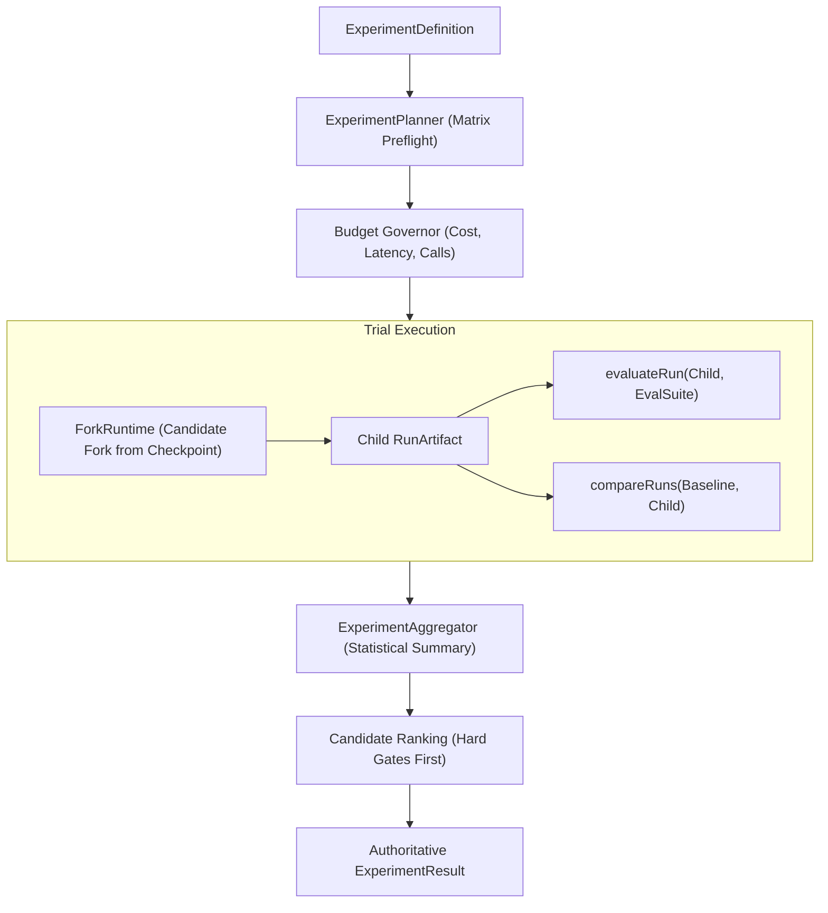

# Experiment Runtime Architecture

> **Canonical Role:** Controlled multi-arm execution engine, statistical aggregator, and policy-driven winner selection.

---

## 1. Overview & Pipeline

The Experiment Runtime orchestrates bounded hypothesis testing across candidate arms using existing runtime primitives:

---

## 2. Invariants

1. **Reuses ForkRuntime:** Reeprov does not introduce a duplicate agent runtime; it leverages `ForkRuntime` to fork candidate runs from recorded checkpoints.
2. **Never Mutates Historical Baselines:** Baseline artifacts remain strictly immutable.
3. **Graceful Budget Exceedance:** When budget limits are reached, execution stops cleanly with status `BUDGET_EXCEEDED` while preserving all completed trials.
4. **Separate Cost Tracking:** Candidate execution cost is tracked independently from evaluator grader cost.
5. **No Automatic Production Promotion:** An experiment result provides an evidence-backed recommendation (`recommended_candidate`), but promotion requires external authorization.

---

## 3. Planning & Budget Governance

### `ExperimentPlanner`
- Enforces matrix size preflight: checks that `total_arms * repetitions <= budget.max_trials`.
- Detects unsupported variable types and flags combinatorial explosion.
- Enforces single-variable isolation where possible and issues warnings when multiple variables are simultaneously changed (causal confounding).

### `ExperimentBudgetGovernor`
- Enforces limits: `max_cost_usd`, `max_trials`, `max_model_calls`, and `max_duration_ms`.
- Checks budget before initiating each trial.
- Accurately aggregates candidate costs vs evaluator costs.

---

## 4. Aggregation & Repeatability

### Statistical Aggregation
For each arm across $N$ repetitions:
- `n`: Number of completed trials.
- `pass_rate`: Percentage of trials passing the eval suite.
- `mean_score`, `median_score`, `min_score`, `max_score`.
- `std_dev_score`: Sample standard deviation computed when $N > 1$.
- `mean_candidate_cost`, `mean_grader_cost`, `mean_total_cost`.
- `mean_latency_ms`.

### Repeatability Invariant
- If $N = 1$, the result explicitly records: `"SINGLE TRIAL — REPEATABILITY UNKNOWN. Results may vary on stochastic model runs."`
- Never claims statistical significance automatically.
