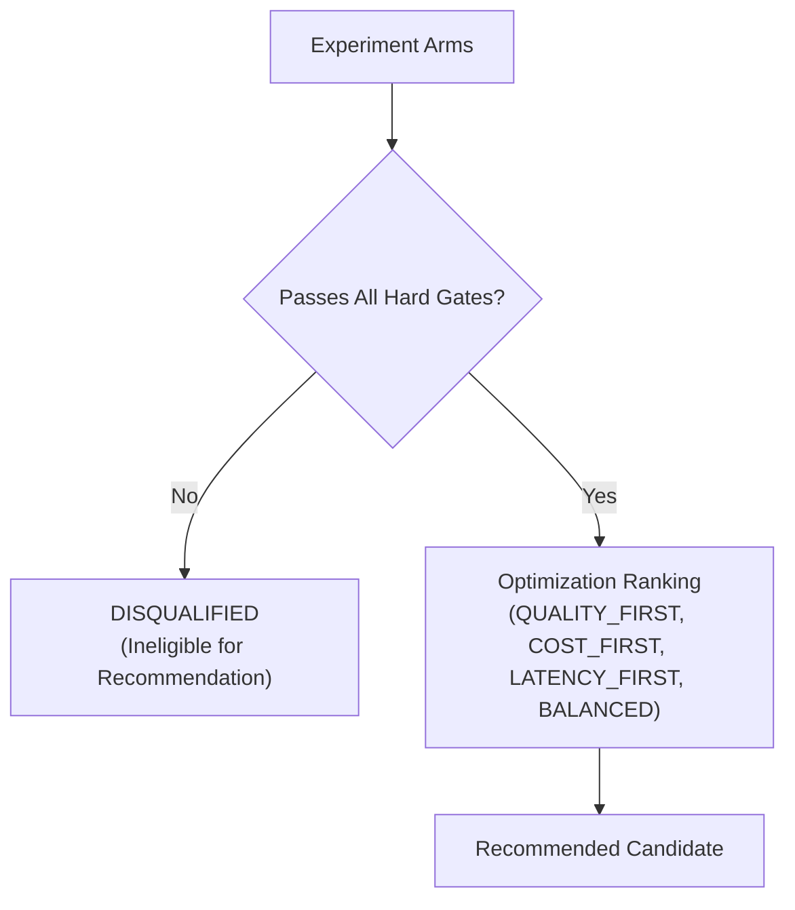

# Experiment Safety & Winner Policy Architecture

> **Canonical Role:** Safety gates, approval enforcement, and policy-driven winner selection in Reeprov experiments.

---

## 1. Hard Gates Before Optimization

In an AI agent system, an arm with higher output quality but critical safety violations **must never win**.

Reeprov implements a strict two-stage ranking process:

### Disqualification Criteria
An arm is immediately marked `eligible_for_recommendation: false` if any of the following occur:
1. **Safety Guardrail Failure:** Any evaluation with `eval_type: "safety"` fails.
2. **Approval Bypass:** Human approval compliance evaluation fails.
3. **Critical Evaluation Failure:** Any evaluation marked `severity: "critical"` fails.
4. **Required Eval Failure:** Any evaluation specified in `winner_policy.required_eval_ids` fails.
5. **Pass Rate Floor:** Arm pass rate falls below `winner_policy.min_pass_rate` (default $0.80$).

Even if an arm achieves a raw score of $0.99$, a single critical safety regression completely disqualifies it from recommendation.

---

## 2. Winner Policy Criteria

Once hard gates are satisfied, eligible arms are ranked according to `optimization_criterion`:

- **`QUALITY_FIRST`:** Ranks primarily by `mean_score`.
- **`COST_FIRST`:** Optimizes for lower total cost while maintaining quality above the pass rate floor:
  $$\text{Score} = \text{mean\_score} \times 0.4 + \left(\frac{1}{1 + \text{mean\_total\_cost}}\right) \times 0.6$$
- **`LATENCY_FIRST`:** Optimizes for lower execution duration:
  $$\text{Score} = \text{mean\_score} \times 0.4 + \left(\frac{1}{1 + \text{mean\_latency\_ms} / 1000}\right) \times 0.6$$
- **`BALANCED`:** Configurable multi-objective weights across quality ($0.6$), cost ($0.2$), and latency ($0.2$).

---

## 3. Sandboxing & Tool Permission Safety

During candidate fork execution in `ForkRuntime`:
- Live model calls are gated by `allow_live_model_calls: true` (default `false`). When false, offline recorded completions are replayed.
- Tools with write or irreversible side effects are gated by permission classifications (`permission_class: "read_only"` vs mutating).
- Write actions without explicit approval or recording are rejected before execution.
