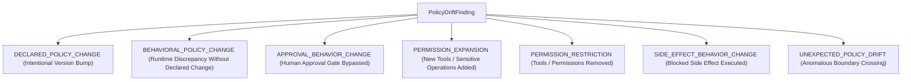
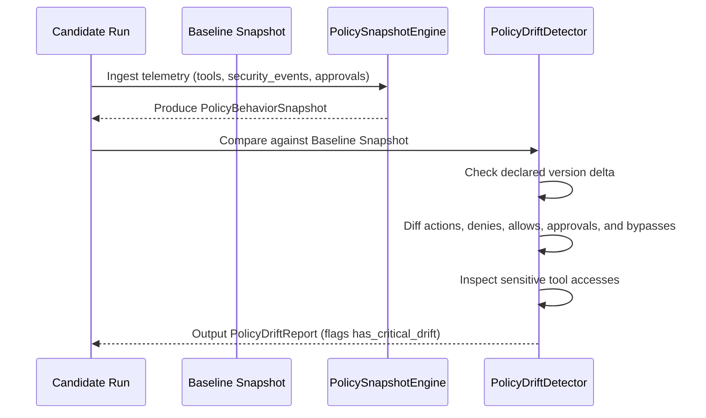

# AgentPulse Policy Drift Detection

## Declared Governance vs Behavioral Realities

### 1. The Core Problem: Declared vs Behavioral Drift

In complex agentic architectures, governance policies are often declared in code or configuration (e.g. "Agent has read-only access to customer records"). However, behavioral execution frequently deviates from declared intentions due to prompt injection, tool hallucination, or improper boundary enforcement.

AgentPulse bifurcates policy into two distinct layers:
1. **Declared Policy**: The permissions, tool authorizations, and human approval gates explicitly configured.
2. **Behavioral Policy**: The actual tools executed, permissions exercised, boundaries touched, and side-effects performed during runtime execution.

---

### 2. Policy Drift Taxonomy



#### Drift Classifications & Severity:

| Drift Type | Severity | Description | Gate Action |
| :--- | :--- | :--- | :--- |
| **`DECLARED_POLICY_CHANGE`** | `INFO` | Policy configuration version was explicitly incremented. | Non-blocking |
| **`PERMISSION_RESTRICTION`** | `INFO` | Candidate removed permissions or unused tools. | Non-blocking |
| **`PERMISSION_EXPANSION` (Non-sensitive)** | `WARNING` | New read-only or safe tools executed by candidate. | Requires Review |
| **`PERMISSION_EXPANSION` (Sensitive)** | `CRITICAL` | Unannounced execution of destructive/sensitive tools (`write`, `delete`, `drop`, `admin`). | **BLOCKS PROMOTION** |
| **`BEHAVIORAL_POLICY_CHANGE`** | `CRITICAL` | Action denied in baseline was allowed in candidate without declared policy change. | **BLOCKS PROMOTION** |
| **`APPROVAL_BEHAVIOR_CHANGE`** | `CRITICAL` | Action requiring human approval in baseline was executed automatically or bypassed. | **BLOCKS PROMOTION** |
| **`SIDE_EFFECT_BEHAVIOR_CHANGE`** | `CRITICAL` | Side-effect blocked in baseline was executed in candidate. | **BLOCKS PROMOTION** |

---

### 3. PolicyBehaviorSnapshot Contract

Captured deterministically from `RunArtifact` execution telemetry:

```typescript
export interface PolicyBehaviorSnapshot {
  policy_snapshot_id: string;
  project_id: string;
  run_id: string;
  policy_id: string;
  policy_version: number;
  configuration_hash: string;
  actions_observed: string[];
  allows: string[];
  denies: string[];
  approval_required: string[];
  approval_granted: string[];
  approval_rejected: string[];
  blocked_side_effects: string[];
  violations: string[];
  bypasses: string[];
  sensitive_tool_accesses: string[];
  declared_permissions: string[];
  captured_at: string;
}
```

---

### 4. Policy Drift Detection Pipeline


