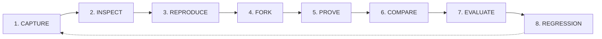
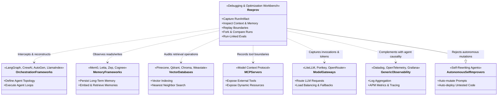

# Reeprov: Canonical North Star Architecture

> **Definition:** Open-source debugging and optimization infrastructure for AI agents.

---

## 1. The Core Loop

Reeprov exists to make AI agent execution intelligible, reproducible, and optimizable. It is structured around the closed-loop developer workflow:

1. **CAPTURE:** Passively and deterministically intercept execution boundaries, context snapshots, tool invocations, model calls, state changes, and memory operations without mutating runtime behavior.
2. **INSPECT:** Render a high-fidelity, causal execution graph answering not just *what* the agent did, but *what it knew*, *where that knowledge originated*, and *why* it chose each action.
3. **REPRODUCE:** Re-instantiate execution at supported boundaries using recorded inputs, sandboxed mocks, or isolated execution environments.
4. **FORK:** Branch an execution from an exact checkpoint step or state snapshot to test alternative hypotheses while preserving parent immutability.
5. **PROVE:** Record the exact effective configuration snapshot (agent, model, prompts, skills, tools, permissions, runtime), explicit non-CoT plans, append-only verification and approval events, security telemetry, and typed test/review outcomes to prove run validity.
6. **COMPARE:** Compute semantic and structural divergence between baseline and mutant runs to determine if the change was an improvement.
7. **EVALUATE:** Execute run-linked quantitative and qualitative graders (eval families: task success, safety, grounding, schema validity, cost, latency).
8. **REGRESSION:** Convert resolved bugs, failure cases, and benchmark runs into persistent regression suites to guard future releases.

---

## 2. The 10 Primary Jobs

Reeprov is engineered to fulfill ten specific technical jobs:

1. **Capture an execution:** Collect structured, versioned runtime envelopes containing immutable evidence of the agent's complete trajectory.
2. **Reconstruct what happened:** Assemble raw trace events into a clean causal execution graph displaying stages, parallel branches, and attached evidence.
3. **Inspect what the agent knew at each decision:** Reconstruct the exact `ContextSnapshot` and memory state available to the model at every single prompt invocation.
4. **Reproduce supported execution boundaries:** Classify external interactions by replayability class and replay recorded outputs safely without triggering uncontrolled side-effects.
5. **Fork an execution from a checkpoint:** Allow developers to mount a historical run at step $N$ with state intact and resume execution along a new path.
6. **Compare runs and identify meaningful divergence:** Provide side-by-side execution diffing that pinpoints the exact step where two runs drifted in trajectory, state, or output.
7. **Evaluate runs and experiments:** Link deterministic and model-graded evaluation results directly to individual runs and execution steps.
8. **Turn reusable failures into regressions:** Transform captured production failures into permanent test fixtures and eval cases.
9. **Measure context, memory, model, prompt, and tool changes:** Quantify the concrete impact of developer interventions on cost, latency, success rate, and eval scores.
10. **Recommend evidence-backed improvements without autonomously modifying production behavior:** Provide actionable diagnostic guidance and suggested fixes while keeping humans firmly in control of code and production configuration.

---

## 3. What Reeprov Is NOT (System Boundaries)

Reeprov occupies a distinct architectural layer. It connects to and audits external systems; it does not replace them.

| Category | Representative Examples | Reeprov Boundary |
|---|---|---|
| **Agent Orchestration Frameworks** | LangGraph, CrewAI, AutoGen, LlamaIndex Workflows, Semantic Kernel | **Does NOT orchestrate.** Reeprov does not run agent execution loops or schedule agent tasks. It intercepts and visualizes what orchestration engines do. |
| **Memory Frameworks** | Mem0, Letta (MemGPT), Zep, Cognee | **Does NOT store or manage memory.** Reeprov provides neutral memory observability: it records what was queried, written, or consolidated. |
| **Vector Databases** | Pinecone, Qdrant, Chroma, Weaviate, Milvus | **Does NOT index or store vectors.** Reeprov captures retrieval queries, chunk IDs, rankings, and scores to measure retrieval quality. |
| **Tool / MCP Servers** | Model Context Protocol servers, OpenAPI tool bridges | **Does NOT host tools.** Reeprov records tool schemas, input arguments, execution outputs, and side-effect classes. |
| **Model Gateways & Proxies** | LiteLLM, Portkey, OpenRouter, Cloudflare AI Gateway | **Does NOT route or balance model calls.** Reeprov ingests model invocation records (tokens, latency, provider, cost) linked to context. |
| **Generic Observability & APM** | Datadog, Grafana, OpenTelemetry, New Relic | **Does NOT replace APM.** APM tracks system spans and infrastructure health. Reeprov tracks semantic agent causality, context provenance, and decision trees. |
| **Generic BI Tools** | Metabase, Tableau, Looker | **Does NOT do ad-hoc generic BI.** Reeprov provides agent-native eval dashboards, token attribution, and trajectory divergence analytics. |
| **Autonomous Self-Improvement** | DSPy auto-optimizers, self-rewriting agent loops | **Does NOT autonomously alter production.** Reeprov produces evidence-backed diagnostic recommendations. Code promotion remains human-gated. |

---

## 4. Architectural Pillars

### Pillar I: Causal Ground Truth Over Loose Telemetry
A flat list of OpenTelemetry spans cannot answer *why* an agent decided to execute a destructive SQL query instead of querying documentation. Reeprov anchors every decision to a causal chain:
$$\text{Memory / State} \longrightarrow \text{Context Snapshot} \longrightarrow \text{Model Invocations} \longrightarrow \text{Tool / Action Boundary} \longrightarrow \text{State Transition}$$

### Pillar II: First-Class Context & Provenance
Every model invocation must link to a `ContextSnapshot`. Context is broken down into structured `ContextItem` records (system policy, agent instructions, skill prompts, active memories, retrieved chunks, conversation history, and few-shot examples). Developers can inspect exact token attribution and provenance for every token fed into the model.

### Pillar III: Memory Distinct From State
- **Run State:** Ephemeral execution state scoped to the active run or workflow instance (e.g. accumulator variables, loop indices, scratchpad).
- **Checkpoints:** Immutable point-in-time state serializations used for resuming or forking.
- **Memory Operations:** Interactions with external long-term semantic, episodic, or procedural memory stores (read, write proposal, commit, consolidate, supersede).
- **Artifacts:** Tangible external assets generated during the run (e.g. PDFs, markdown reports, source code files).

### Pillar IV: Replayability Semantics & Side-Effect Gating
A trace is **not** automatically replayable. Replaying an agent requires deterministic handling of non-deterministic boundaries. Every external interaction is classified by:
1. **Replayability Class:** `REPLAYABLE_RECORDED`, `REPLAYABLE_DETERMINISTIC`, `REPLAYABLE_SANDBOXED`, `LIVE_REQUIRED`, `SIDE_EFFECT_GATED`, `NON_REPLAYABLE`, `UNKNOWN`.
2. **Side-Effect Class:** `read_only`, `write_draft`, `external_side_effect`, `sensitive_data`, `destructive`.

Replay engines can safely mock recorded inputs, route write drafts to sandboxes, and gate destructive calls behind explicit approvals.

> **Implemented in Sprint 2:** Replay-grade boundary capture is fully implemented in [`lib/core/capture/`](../../lib/core/capture/), featuring content-addressed deduplication, server-side secret sanitization, context snapshot materialization, and the deterministic [`BoundaryReplayHarness`](../../lib/core/capture/replayHarness.ts). For details, see [`replay-grade-capture.md`](../../docs/architecture/replay-grade-capture.md) and [`boundary-model.md`](../../docs/architecture/boundary-model.md).

### Pillar V: Run-Linked Evaluation as Proof
Evaluations are not floating metrics in a separate spreadsheet. An `EvalResult` is cryptographically and causally linked to a `target_run_id` and optional `target_step_id`. Whether evaluated by a deterministic rule, a benchmark dataset, or a model-graded evaluator, evals form the verifiable proof of agent performance.

---

## 5. Security & Isolation Invariants

1. **Server-Side Security:** Scanned or audited repository tokens (`GITHUB_TOKEN`, integration keys) must never reach the client browser.
2. **Zero Code Execution of Audited Repositories:** Reeprov does not execute code or install dependencies from scanned repositories.
3. **Data Redaction & Sanitization:** All credentials, private keys, API secrets, and sensitive tokens are redacted before storage or display.
4. **Untrusted Evidence:** Traces, prompts, and agent outputs are treated as untrusted data. The workbench never obeys prompt injection instructions embedded in captured agent traces.
5. **Human-in-the-Loop Optimization:** Optimization suggestions are emitted as structured candidate diffs or test cases. Reeprov never unilaterally alters production prompts, memory, or runtime configurations.
