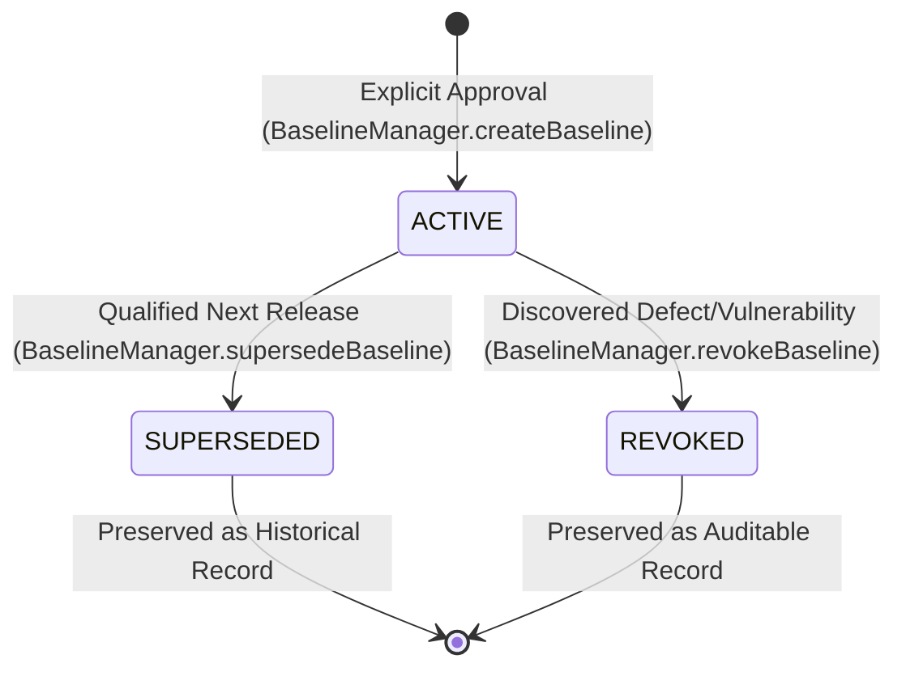
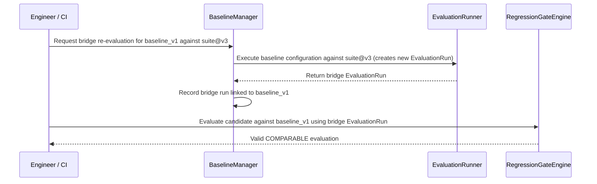

# AgentPulse Regression Baselines

## Explicit, Immutable, and Auditable Baselines

### 1. Architectural Philosophy: No Implicit Baselines

A common trap in continuous integration for agents is implicitly treating the "latest passing run" as the baseline. This causes catastrophic regression creep: an agent incrementally degrades by 1% across 10 PRs without failing any single step.

AgentPulse enforces **Explicit Baselines**:
- Baselines are never automatically updated on test completion.
- Baselines represent an explicitly qualified, reviewed, and approved agent release standard.
- Baselines are immutable: historical evaluation evidence is sealed and cannot be overwritten.

---

### 2. RegressionBaseline Contract

```typescript
export interface RegressionBaseline {
  baseline_id: string;               // Unique ID, e.g. "base_support_prod_v1"
  project_id: string;                // Project namespace
  agent_id?: string;                 // Target agent identifier
  run_id?: string;                   // Canonical RunArtifact ID
  configuration_hash: string;        // SHA-256 of models, prompts, tools, skills
  eval_suite_id: string;             // Exact EvalSuite used for qualification
  eval_suite_version: number;        // Monotonic version of EvalSuite
  dataset_id?: string;               // Exact EvalDataset used
  dataset_version?: number;          // Monotonic version of EvalDataset
  approved_at: string;               // ISO 8601 timestamp
  approved_by?: string;              // Engineer, security officer, or QA team
  label?: string;                    // Human-readable release label (e.g. "Production v1.2.0")
  release_version?: string;          // SemVer tag
  evidence_hash: string;             // Cryptographic digest sealing the baseline record
  status: "ACTIVE" | "SUPERSEDED" | "REVOKED";
  metadata: Record<string, unknown>;
}
```

---

### 3. Baseline Lifecycle & Immutability Invariant



#### Invariants:
1. **Evidence Sealing**: When a baseline is created or approved, its configuration, evaluation IDs, suite version, and dataset version are hashed into `evidence_hash`.
2. **Version Succession**: When a new baseline is established to replace an existing one, `BaselineManager.supersedeBaseline` marks `baseline_v1` as `SUPERSEDED` and registers `baseline_v2`. Historical decisions made against `v1` remain verifiable forever.
3. **Revocation Audit**: If a baseline is found to harbor security or safety flaws post-facto, it can be transitioned to `REVOKED` with a mandatory reason and approving actor.

---

### 4. Bridge Re-Evaluation Workflow

When an evaluation suite or dataset evolves (e.g. from `release@v2` to `release@v3` or `dataset@v1` to `dataset@v2`), direct comparison against an older baseline would be an **apples-to-oranges violation**.

AgentPulse implements a controlled bridge workflow:



- **Never Rewrites History**: The original historical `EvaluationRun` of `baseline_v1` is untouched.
- **Creates Bridge Evidence**: A new `EvaluationRun` is created capturing the baseline agent executing under the candidate's new test harness.
- **Enables Valid Longitudinal Tracking**: Eliminates false regression alerts caused purely by updated grading rubrics.
