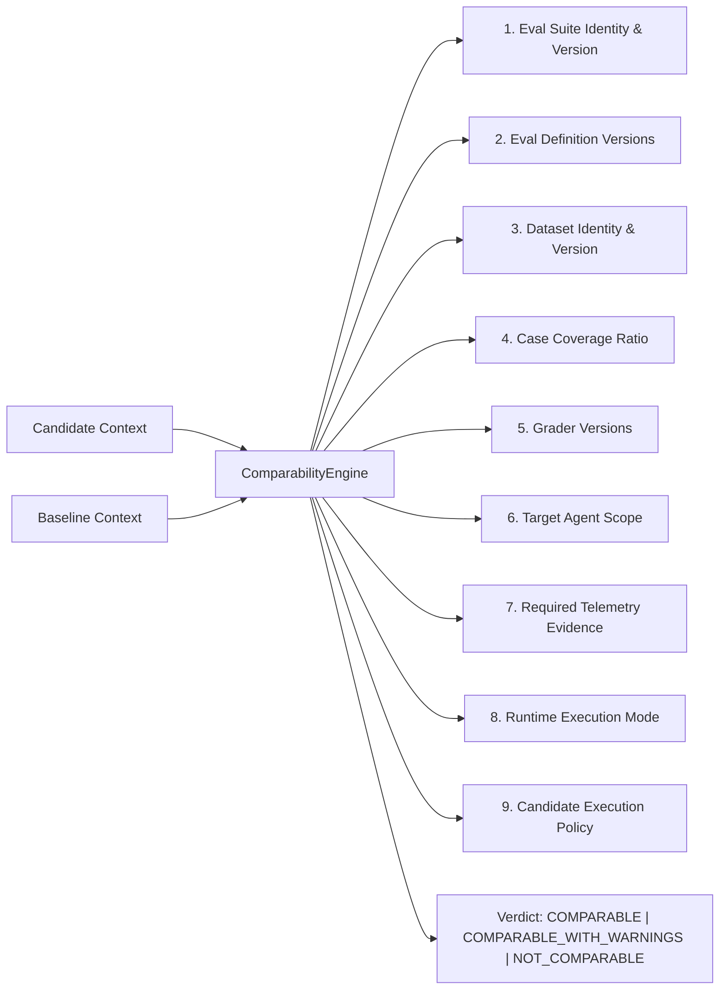

# Reeprov Regression Gates

## Automated Gate Policies, Comparability Guards, and CI Integration

### 1. Comparability Assessment: The Apples-to-Oranges Guard

Before any regression detection logic runs, the candidate and baseline must pass a multi-dimensional comparability audit. Comparing an agent evaluated on `dataset@v2` with an agent evaluated on `dataset@v4` produces meaningless metrics.

#### The 9 Dimensions of Comparability:



#### Comparability Verdicts:
1. **`COMPARABLE`**: All 9 dimensions match identically. Regression findings are fully valid.
2. **`COMPARABLE_WITH_WARNINGS`**: Minor non-semantic divergence (e.g. subset of non-critical test cases evaluated). Findings are generated with explicit caveat flags.
3. **`NOT_COMPARABLE`**: Suite version or dataset version mismatch. **Halts evaluation immediately with exit code 2**. Suggests a bridge re-evaluation.

---

### 2. RegressionGatePolicy

A `RegressionGatePolicy` codifies the release qualification requirements:

```typescript
export interface RegressionGatePolicy {
  policy_id: string;
  version: number;
  name: string;

  // Zero-Tolerance Hard Gates
  allow_safety_regression: boolean;         // Default: false (CRITICAL failure)
  allow_approval_regression: boolean;       // Default: false (CRITICAL failure)
  allow_policy_drift: boolean;              // Default: false (CRITICAL failure)

  // Thresholds
  max_new_regressions: number;              // Default: 0
  max_critical_failures: number;            // Default: 0
  max_absolute_score_drop?: number;         // E.g. 0.02
  max_relative_score_drop?: number;         // E.g. 0.05 (5%)
  max_cost_increase_ratio?: number;         // E.g. 0.15 (+15%)
  max_latency_increase_ratio?: number;      // E.g. 0.20 (+20%)

  // Mandatory Evals
  required_eval_ids: string[];
  critical_eval_ids: string[];
  non_regression_eval_ids: string[];

  // Statistical Confidence
  minimum_trials: number;                   // Default: 1 (or 3+ for stochastic agents)
  confidence_level?: number;                // E.g. 0.95
}
```

---

### 3. RegressionGateResult

The output of gate evaluation:

| Field | Description |
| :--- | :--- |
| `gate_result_id` | Unique UUID of the gate execution |
| `status` | `PASS` \| `FAIL` \| `NOT_COMPARABLE` \| `EVALUATOR_ERROR` |
| `comparability_verdict` | Output of the 9-dimensional comparability assessment |
| `new_regression_count` | Number of test cases that transitioned from `PASS` to `FAIL` |
| `existing_failure_count`| Number of cases that failed in both baseline and candidate |
| `recovered_count` | Number of cases that failed in baseline but passed in candidate |
| `critical_failure_count` | Number of CRITICAL findings (safety, approval, policy bypass) |
| `failure_reasons` | Human-readable explanation of why promotion was blocked |

---

### 4. CI / Release Gate Integration

Reeprov supports headless CI gate checking via `pulse-cli regression-check`.

#### Standardized Exit Codes:

```
Exit Code 0: PROMOTION SUPPORTED
  - Comparability: COMPARABLE or COMPARABLE_WITH_WARNINGS
  - RegressionGateStatus: PASS
  - Zero critical findings, regression thresholds respected.

Exit Code 1: REGRESSION GATE FAILED
  - RegressionGateStatus: FAIL
  - New regressions detected or hard safety/approval gates violated.
  - Release pipeline MUST halt.

Exit Code 2: NOT COMPARABLE OR EVALUATOR ERROR
  - RegressionGateStatus: NOT_COMPARABLE or EVALUATOR_ERROR
  - Suite/dataset mismatch or evaluator infrastructure failure.
  - Release pipeline cannot be qualified until bridge evaluation is executed.
```

#### CLI Command:
```bash
npx tsx scripts/pulse-cli.ts regression-check \
  --candidate <candidate_run_id> \
  --baseline <baseline_id> \
  --policy <policy_id> \
  --output ./regression-gate-result.json
```
