# Reeprov Regression Model

## Continuous Evidence Across Agent Versions

### 1. Architectural Mission & Core Definition

In Reeprov, **Regression** has a strict, unambiguous definition:

> **Regression** means: *"A candidate performs materially worse than an explicitly selected baseline under comparable evaluation conditions."*

Crucially, **Regression does NOT mean:**
- "The newest run differs from the previous run." (That is Divergence, handled in Sprint 6.)
- "A test case failed." (If the test case also failed on the baseline, that is an Existing Failure, not a regression.)
- "A metric fluctuated microscopically." (Floating-point noise is ignored via explicit tolerance thresholds.)
- "A candidate was evaluated against an altered suite or dataset." (That is Not Comparable; apples-to-oranges comparisons are rejected before regression analysis.)

---

### 2. Regression vs Divergence vs Failure

Reeprov maintains clear boundaries across the diagnostic and evaluative pipeline:

| Concept | Definition | Scope | Gate Impact |
| :--- | :--- | :--- | :--- |
| **Divergence** | Structural, lexical, or step-order differences between two executions. | Single pair of runs | Informational / Diagnostic |
| **Failure** | Violation of an evaluation assertion or task objective. | Run vs Evaluator Rubric | Diagnostic |
| **Existing Failure** | A case that failed in the baseline and continues to fail in the candidate. | Paired baseline & candidate | Non-blocking unless policy forbids |
| **New Regression** | A case that **PASSED** in the baseline but **FAILS** in the candidate under identical conditions. | Paired baseline & candidate | **BLOCKS PROMOTION** (Gate Failure) |
| **Recovery** | A case that **FAILED** in the baseline but **PASSES** in the candidate. | Paired baseline & candidate | Positive signal |

---

### 3. Regression Taxonomy

Reeprov categorizes regression into deterministic, auditable categories:

```mermaid
graph TD
    Finding["RegressionFinding"] --> CR["CASE_REGRESSION (Paired Case Transition)"]
    Finding --> TSR["TASK_SUCCESS_REGRESSION (Task Completion Drop)"]
    Finding --> QR["QUALITY_REGRESSION (Rubric / Quality Degradation)"]
    Finding --> SR["SAFETY_REGRESSION (Zero-Tolerance Safety Violation)"]
    Finding --> AR["APPROVAL_REGRESSION (Bypass or Missing Approval Gate)"]
    Finding --> PR["POLICY_REGRESSION (Declared vs Behavioral Shift)"]
    Finding --> TBR["TOOL_BEHAVIOR_REGRESSION (Tool Failure / Schema Deviation)"]
    Finding --> RR["RETRIEVAL_REGRESSION (Groundedness / Precision Drop)"]
    Finding --> CR2["CONTEXT_REGRESSION (Context Window Degradation)"]
    Finding --> MR["MEMORY_REGRESSION (State Inconsistency / Amnesia)"]
    Finding --> CostR["COST_REGRESSION (Relative Budget Surge)"]
    Finding --> LatR["LATENCY_REGRESSION (P95 Latency SLA Violation)"]
    Finding --> RelR["RELIABILITY_REGRESSION / FLAKINESS_INCREASE"]
    Finding --> ER["EVIDENCE_REGRESSION (Missing Telemetry Evidence)"]
```



#### Detailed Taxonomy Categories

1. **`CASE_REGRESSION`**: An exact case ID transitioned from `PASS` in baseline to `FAIL` in candidate. This is the highest-signal regression primitive.
2. **`TASK_SUCCESS_REGRESSION`**: Drop in global or per-task success rate beyond allowed relative/absolute thresholds.
3. **`QUALITY_REGRESSION`**: Drop in benchmark or qualitative score exceeding defined degradation tolerance.
4. **`SAFETY_REGRESSION`**: Transition from `PASS` to `FAIL` on guardrails, prompt injection defenses, or PII leak evaluations. Always **CRITICAL** severity.
5. **`APPROVAL_REGRESSION`**: Actions requiring human-in-the-loop sign-off were executed automatically or bypassed. Always **CRITICAL** severity.
6. **`POLICY_REGRESSION`**: Agent executed undeclared actions, unauthorized sensitive tools, or breached permission boundaries.
7. **`TOOL_BEHAVIOR_REGRESSION`**: Higher tool execution error rate, malformed arguments, or invalid tool selection.
8. **`RETRIEVAL_REGRESSION`**: Degradation in citation recall, grounding precision, or context faithfulness.
9. **`CONTEXT_REGRESSION`**: Unnecessary context bloat, truncated working memory, or token overflow.
10. **`MEMORY_REGRESSION`**: Loss of entity memory across steps, contradictory state mutations, or cache corruption.
11. **`COST_REGRESSION`**: Monetary cost per successful task grew beyond threshold (e.g. `> +15%`).
12. **`LATENCY_REGRESSION`**: P95 task duration exceeded threshold (e.g. `> +20%`).
13. **`RELIABILITY_REGRESSION` / `FLAKINESS_INCREASE`**: Increase in trial-to-trial variance across repeated runs.
14. **`EVIDENCE_REGRESSION`**: Telemetry dropped required fields, unverified redactions, or missing execution traces.

---

### 4. Paired Case Transition Matrix

When evaluating a candidate against a shared `EvalDataset`, Reeprov indexes cases by their canonical `eval_case_id`:

```
Case State Matrix:
+-------------------+-------------------+-------------------------+
| Baseline Result   | Candidate Result  | Classification          |
+-------------------+-------------------+-------------------------+
| PASS              | PASS              | UNCHANGED_PASS          |
| PASS              | FAIL              | NEW_REGRESSION          |
| FAIL              | FAIL              | EXISTING_FAILURE        |
| FAIL              | PASS              | RECOVERED               |
| PASS / FAIL       | MISSING / ERROR   | EVALUATOR_ERROR         |
+-------------------+-------------------+-------------------------+
```

Only `NEW_REGRESSION` increments the regression count. `EXISTING_FAILURE` is surfaced in reports for visibility but does not trigger non-regression gate failures.

---

### 5. Threshold-Based Score Degradation

To prevent flagging microscopic floating-point movement as regressions, Reeprov enforces explicit tolerances:

- **Absolute Drop**: $\Delta = \text{Score}_{\text{baseline}} - \text{Score}_{\text{candidate}} > \text{max\_absolute\_drop}$
- **Relative Drop**: $\frac{\text{Score}_{\text{baseline}} - \text{Score}_{\text{candidate}}}{\text{Score}_{\text{baseline}}} > \text{max\_relative\_drop}$

Default degradation allowance is strictly `0.00` unless explicitly relaxed by a `RegressionGatePolicy`.

---

### 6. Stochastic Variance vs Definitive Regression

A non-deterministic LLM agent cannot be fairly judged by comparing one baseline trial to one candidate trial.

Reeprov integrates Sprint 8 repetition evidence:
- **`minimum_trials` Enforcement**: Strong regression claims require $N \ge \text{minimum\_trials}$ (e.g. 3 or 5).
- **Statistical Aggregation**: Mean, median, standard deviation, and pass rate are computed across arms.
- **Honest Causal Attribution**:
  - If $N < \text{minimum\_trials}$: flagged with causal status `OBSERVED_DROP` (non-definitive language).
  - If $N \ge \text{minimum\_trials}$ with confidence: flagged with `DEFINITIVE_REGRESSION` or `PROBABILISTIC_REGRESSION`.
