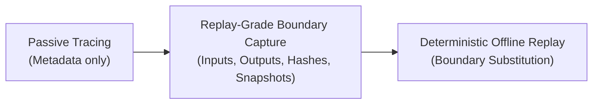
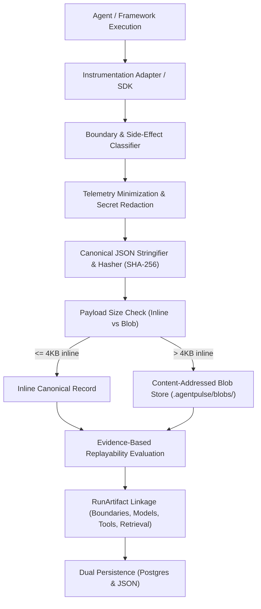

# Replay-Grade Boundary Capture Architecture

> **Definition:** The capture subsystem within AgentPulse responsible for intercepting, sanitizing, deduplicating, and recording nondeterministic agent interactions with sufficient fidelity to deterministically substitute their recorded outputs later.

---

## 1. Executive Summary & Objective

In prior iterations, AgentPulse observed execution telemetry primarily as lightweight trace events (*"an LLM call occurred"*, *"tool `search` ran"*). While sufficient for rendering passive timeline graphs, traces alone cannot support offline replay, deterministic debugging, counterfactual forking, or regression test execution.

This architecture establishes **Replay-Grade Boundary Capture**, bridging the gap between:



The system strictly adheres to the core architectural decision:
- **The instrumentation layer observes.**
- **It does NOT own agent control flow.**
- **The application/runtime remains authoritative for execution.**

---

## 2. Pipeline Architecture

Every external interaction passes through a structured, multi-stage capture pipeline:



### Pipeline Modules in [`lib/core/capture/`](file:///Users/raulm/Desktop/GitHub/AgentPulse/lib/core/capture/)

1. **[`types.ts`](file:///Users/raulm/Desktop/GitHub/AgentPulse/lib/core/capture/types.ts):** Type definitions for capture policies, redaction results, adapter payloads, and storage interfaces.
2. **[`policy.ts`](file:///Users/raulm/Desktop/GitHub/AgentPulse/lib/core/capture/policy.ts):** Configurable capture policies (`STRUCTURE_ONLY`, `SAFE_CONTENT`, `FULL_CONTENT`), payload size thresholds, and sensitive field lists.
3. **[`hashing.ts`](file:///Users/raulm/Desktop/GitHub/AgentPulse/lib/core/capture/hashing.ts):** Deterministic object sorting and canonical serialization (`canonicalJsonStringify`) with SHA-256 / SHA-512 cryptographic hashing.
4. **[`redaction.ts`](file:///Users/raulm/Desktop/GitHub/AgentPulse/lib/core/capture/redaction.ts):** Server-side secret scrubbing engine covering 8 distinct secret families and sensitive object/header keys.
5. **[`contentStore.ts`](file:///Users/raulm/Desktop/GitHub/AgentPulse/lib/core/capture/contentStore.ts):** Content-addressed blob store providing transparent deduplication across runs and steps.
6. **[`sideEffectClassifier.ts`](file:///Users/raulm/Desktop/GitHub/AgentPulse/lib/core/capture/sideEffectClassifier.ts):** Conservative, fail-closed side-effect classification (`read_only`, `write_draft`, `external_side_effect`, `sensitive_data`, `destructive`).
7. **[`replayabilityClassifier.ts`](file:///Users/raulm/Desktop/GitHub/AgentPulse/lib/core/capture/replayabilityClassifier.ts):** Evidence-based evaluation ensuring recorded outputs exist before marking boundaries replayable.
8. **[`boundaryClassifier.ts`](file:///Users/raulm/Desktop/GitHub/AgentPulse/lib/core/capture/boundaryClassifier.ts):** Boundary normalization and dependency identity derivation.
9. **[`normalizeBoundary.ts`](file:///Users/raulm/Desktop/GitHub/AgentPulse/lib/core/capture/normalizeBoundary.ts):** Core pipeline coordinator synthesizing boundaries according to canonical contracts.
10. **[`contextSnapshotBuilder.ts`](file:///Users/raulm/Desktop/GitHub/AgentPulse/lib/core/capture/contextSnapshotBuilder.ts):** Assembles fine-grained `ContextSnapshot` records linking model inputs to source types and hashes.
11. **[`sdk.ts`](file:///Users/raulm/Desktop/GitHub/AgentPulse/lib/core/capture/sdk.ts):** TypeScript client SDK exposing transparent function wrappers (`wrapTool`, `wrapModel`) and manual boundary capture methods with non-fatal failure isolation.
12. **[`persistence.ts`](file:///Users/raulm/Desktop/GitHub/AgentPulse/lib/core/capture/persistence.ts):** High-reliability persistence supporting both `.agentpulse/runs/{runId}.canonical.json` filesystem store and PostgreSQL (`ap_canonical_runs`).
13. **[`replayHarness.ts`](file:///Users/raulm/Desktop/GitHub/AgentPulse/lib/core/capture/replayHarness.ts):** Offline substitution harness validating boundary sequence, side-effect gates, and input hashes without live provider connectivity.

---

## 3. Content-Addressed Storage & Deduplication

In complex multi-turn agent runs, prompts, system instructions, and retrieved context chunks are repeated across consecutive LLM turns. Blindly persisting full context payloads on every step leads to exponential storage bloat.

AgentPulse implements a **content-addressed blob store**:
- Every payload (input or output) is canonically serialized via recursive key sorting.
- A cryptographic SHA-256 digest is generated (`sha256:<hex>`).
- Payloads exceeding `maxInlineBytes` (default: 4,096 bytes) are written to the blob store keyed by their hash:
  - Local filesystem: `.agentpulse/blobs/<prefix>/<hash>.blob`
  - PostgreSQL: `ap_content_blobs (blob_hash, content, byte_size, mime_type, created_at)`
- Payloads smaller than `maxInlineBytes` remain inline in the boundary record for zero-latency retrieval.
- If an identical prompt or retrieved document appears in 50 consecutive steps, it is stored in the blob table **exactly once**.

### Explicit Payload Availability States

AgentPulse never represents missing payloads as empty objects `{}` or `null`. Boundaries explicitly state their payload status:

| State | Definition |
|---|---|
| `CAPTURED` | Payload captured in full (inline or via `content_ref`). |
| `REDACTED` | Content captured with sensitive fields replaced by redaction markers. |
| `HASH_ONLY` | Content omitted per `STRUCTURE_ONLY` policy; only cryptographic hash retained. |
| `TRUNCATED` | Payload exceeded maximum allowed size threshold (`maxPayloadBytes`). |
| `NOT_CAPTURED` | Instrumentation explicitly did not capture payload for this boundary. |
| `UNAVAILABLE` | External failure or storage eviction prevented payload capture. |

---

## 4. Integration Surface & SDK Design

The capture subsystem provides multi-language capture support:

### TypeScript Capture SDK (`lib/core/capture/sdk.ts`)

```typescript
import { agentpulse } from "@/lib/core/capture/sdk";

// 1. Start run session
const session = agentpulse.startRun({
  projectId: "support-triage",
  workflowId: "triage-v1",
  policy: { mode: "SAFE_CONTENT" },
});

// 2. Wrap tools transparently (non-invasive observation)
const fetchAccount = session.wrapTool(
  async (args: { customerId: string }) => {
    return db.accounts.findUnique({ where: { id: args.customerId } });
  },
  { name: "get_customer_account", permissionClass: "read_only" }
);

// 3. Or directly capture model calls
await session.captureModel({
  model: "claude-3-5-sonnet",
  provider: "anthropic",
  prompt: "Synthesize triage plan...",
  response: "Approved refund.",
  inputTokens: 350,
  outputTokens: 42,
  startedAt: startIso,
});

// 4. Conclude session and retrieve canonical RunArtifact
const artifact = await session.finishRun({ status: "completed" });
```

### Non-Fatal Instrumentation Invariant
In production environments (`strict: false`), capture failures (such as storage timeouts, serialization errors, or disk saturation) emit structured diagnostics but **never terminate the user's running agent execution**.
