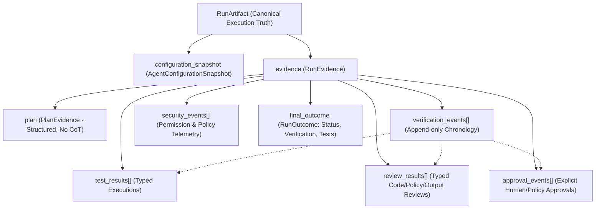

# AgentPulse Run Evidence Model

## Overview

AgentPulse captures, inspects, reproduces, forks, and now **proves** agent execution.
The Run Evidence Model extends `RunArtifact` with a first-class evidence plane that captures the verifiable proof of an agent's execution without creating a disconnected or competing run representation.



---

## 1. Extension of RunArtifact

The evidence plane is embedded directly inside the canonical `RunArtifact`:

```typescript
export interface RunArtifact {
  schema_version: "1.0.0-alpha";
  identity: RunIdentity;
  execution: RunExecution;
  environment: RunEnvironment;
  trajectory: ExecutionStep[];
  boundaries: ExecutionBoundary[];
  state: StateSnapshot[];
  checkpoints: CheckpointReference[];
  lineage: RunLineage;
  // Sprint 5 Evidence Extensions
  configuration_snapshot?: AgentConfigurationSnapshot;
  evidence?: RunEvidence;
}
```

This guarantees:
1. **Single Source of Truth:** Evidence is physically and cryptographically bound to the trajectory, boundaries, and checkpoints.
2. **Backwards Compatibility:** Legacy runs without `evidence` parse without errors.
3. **Immutability:** Once serialized, the artifact (including its evidence and configuration) is immutable.

---

## 2. Explicit Plan Evidence (No Hidden CoT)

`PlanEvidence` captures structured, explicitly emitted plans. It strictly forbids private model reasoning, internal thoughts, or scratchpads.

```typescript
export interface PlanEvidence {
  plan_id: string;
  run_id: string;
  step_id?: string;
  goal: string;
  items: PlanItem[];
  created_at: string;
  producer: string;
  version?: string;
  artifact_ref?: string;
  status: "PLANNED" | "IN_PROGRESS" | "COMPLETED" | "FAILED" | "SKIPPED" | "CANCELLED";
}

export interface PlanItem {
  id: string;
  description: string;
  status: "PLANNED" | "IN_PROGRESS" | "COMPLETED" | "FAILED" | "SKIPPED" | "CANCELLED";
  dependencies: string[];
  evidence_refs: string[];
}
```

### Strict Non-CoT Validation
Attempts to inject fields such as `reasoning`, `thought`, `chain_of_thought`, or `scratchpad` are rejected with explicit schema validation errors. AgentPulse only records declared commitments, not ungrounded chain-of-thought tokens.

---

## 3. Append-Only Verification Chronology & Typed Results

AgentPulse decouples **lifecycle chronology** from **typed result records**:

1. **`VerificationEvent`:** Append-only timeline entries with strictly monotonic sequence indices (`test.started`, `test.passed`, `review.started`, `eval.passed`, `approval.requested`).
2. **`TestResult`:** Normalized results containing test suite, name, status (`PASSED`, `FAILED`, `SKIPPED`, `ERROR`), attempt count, execution duration, and content references for unbounded stdout/stderr.
3. **`ReviewResult`:** Normalized reviews (`CODE`, `OUTPUT`, `SECURITY`, `POLICY`, `HUMAN`, `AUTOMATED`) with explicit findings, severity levels, and evidence references.
4. **`EvalResult`:** Existing evaluation contracts are referenced by verification events, eliminating redundant eval data models.

---

## 4. Run Outcome Contract

A successful HTTP 200 execution does not equal a successful run. A run may complete technically while failing its policy, tests, or security checks.

`RunOutcome` records the comprehensive, multi-dimensional outcome:

```typescript
export interface RunOutcome {
  status: "SUCCESS" | "FAILURE" | "PARTIAL_SUCCESS" | "BLOCKED" | "CANCELLED" | "UNKNOWN";
  reason_code?: string;
  summary?: string;
  output_ref?: string;
  verification_status: "PASS" | "FAIL" | "PARTIAL" | "NOT_RUN";
  tests_status?: "PASS" | "FAIL" | "SKIPPED" | "NOT_RUN";
  review_status?: "PASS" | "FAIL" | "CHANGES_REQUESTED" | "NOT_RUN";
  eval_status?: "PASS" | "FAIL" | "NOT_RUN";
  security_status?: "PASS" | "VIOLATION" | "BLOCKED" | "NOT_RUN";
  completed_at: string;
}
```

---

## 5. Evidence Completeness Scoring

Every run can be evaluated for evidence completeness across 9 canonical dimensions:
- `configuration`
- `plan`
- `tools`
- `tests`
- `review`
- `verification`
- `permissions`
- `artifacts`
- `outcome`

Completeness policies define required dimensions (e.g., `["configuration", "tests", "outcome"]`). If any required dimension is missing, the run fails the evidence policy check, providing an automated gate for CI/CD and deployment pipelines.
