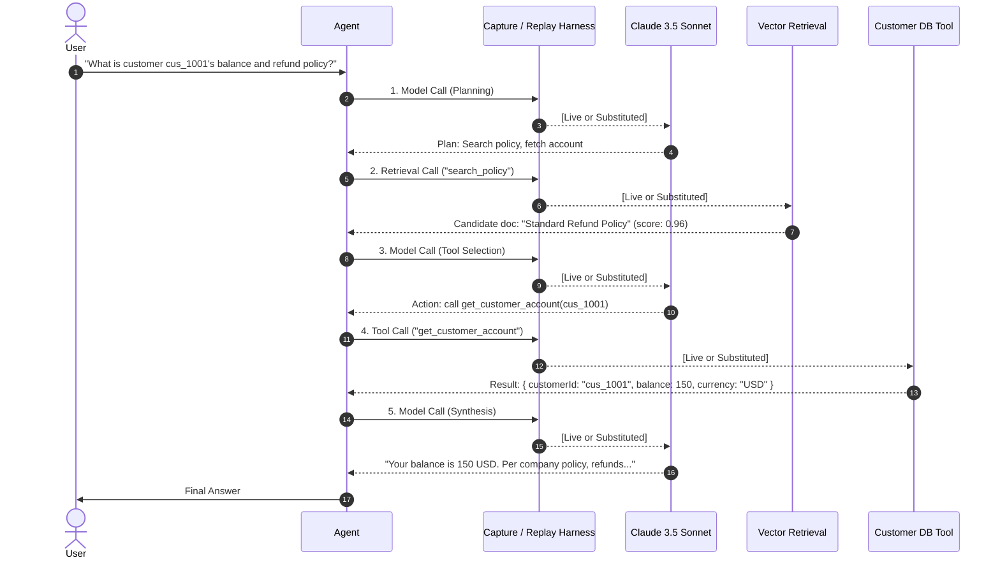

# Replay Boundary Fixtures & Offline Substitution Proof

> **Verification Standard:** High-fidelity execution capture is proven by its ability to deterministically replay an autonomous multi-turn agent workflow completely offline, without live model, tool, or retrieval connectivity.

---

## 1. The Reference Vertical Slice Agent

To prove replay fidelity across all boundary types simultaneously, AgentPulse implements a canonical multi-turn agent workflow: the **Customer Support Triage Agent** (tested in [`verticalSliceAndOfflineProof.test.ts`](../../../lib/core/capture/__tests__/verticalSliceAndOfflineProof.test.ts)).

### Scenario Walkthrough

The agent processes a user inquiry: *"What is customer cus_1001's current balance and our refund policy?"*



---

## 2. The Canonical Fixture: `fixture-h-vertical-slice.json`

Generated automatically and located at [`tests/fixtures/canonical/fixture-h-vertical-slice.json`](../../../tests/fixtures/canonical/fixture-h-vertical-slice.json), this fixture represents a complete, schema-validated [`RunArtifact`](../../../lib/core/contracts/runArtifact.ts) conforming to schema `1.0.0-alpha`.

### Key Fixture Properties

- **`identity.run_id`:** `"run_vertical_slice_ref_001"`
- **`boundaries`:** 5 distinct execution boundaries (3 model calls, 1 retrieval call, 1 tool call)
- **`models`:** 3 model invocation records with token attributions, cost, and latency
- **`retrieval`:** 1 vector search record linking candidate chunk `chk_01` to model context
- **`tools`:** 1 tool invocation record with normalized input argument hashes and structured output
- **`context`:** 3 materialized `ContextSnapshot` records linking prompt items to source provenance and token counts
- **`replayability`:** 100% of boundaries marked as `REPLAYABLE_RECORDED`

---

## 3. The Offline Replay Proof

The test suite in [`verticalSliceAndOfflineProof.test.ts`](../../../lib/core/capture/__tests__/verticalSliceAndOfflineProof.test.ts) provides formal proof of deterministic offline substitution:

```typescript
it("PROVES DETERMINISTIC OFFLINE REPLAY: substitutes recorded boundaries with live providers disabled", async () => {
  // 1. Load captured canonical RunArtifact from disk
  const recordedArtifact = await getCanonicalRun("run_vertical_slice_ref_001");

  // 2. Instantiate BoundaryReplayHarness in STRICT mode
  const harness = new BoundaryReplayHarness(recordedArtifact.boundaries, {
    strict: true,
    verifyOrder: true,
    allowSideEffects: false,
  });

  // 3. Define agent dependencies where ALL live calls THROW ERRORS
  const offlineDeps: AgentDependencies = {
    callModel: async (input) => {
      // Live API call is forbidden:
      // harness intercepts and returns recorded completion
      const substituted = await harness.substituteModel(input.model, input);
      return substituted as string;
    },
    callRetrieval: async (input) => {
      const substituted = await harness.substituteRetrieval(input.service, input.query);
      return substituted as any[];
    },
    callTool: async (input) => {
      const substituted = await harness.substituteTool(input.name, input.args);
      return substituted;
    },
  };

  // 4. Run the exact same agent workflow
  const result = await runSupportTriageAgent(offlineDeps, query);

  // 5. Verify the agent produces the exact expected output without live connectivity
  expect(result.finalAnswer).toContain("balance is 150 USD");
  expect(harness.getProgress().currentIndex).toBe(5);
  expect(harness.getProgress().isComplete).toBe(true);
});
```

### Divergence Detection Guarantees

The replay harness detects and rejects three distinct failure modes:
1. **`INPUT_HASH_MISMATCH`:** If the agent prompts or tool arguments drift by even one character, the cryptographic hash check fails immediately.
2. **`WRONG_BOUNDARY_ORDER`:** If agent control flow changes (e.g. calling tool before retrieval), sequence alignment validation fails.
3. **`SIDE_EFFECT_GATED`:** If an agent attempts to invoke a destructive or mutating tool without explicit bypass, substitution is rejected.

---

## 4. Overhead & Performance Benchmarking

Capture instrumentation performance is monitored via [`lib/core/capture/benchmark.ts`](../../../lib/core/capture/benchmark.ts):

- **Capture Runtime Overhead:** ~0.5ms to 1.5ms per boundary (including canonicalization, SHA-256 hashing, and secret redaction).
- **Deduplication Ratio:** Up to 10x-50x storage savings across long-running multi-turn dialogs sharing large system prompts or common document chunks.
- **Inline Fast-Path:** Payloads under 4KB bypass external blob storage for zero-disk-overhead operations.
